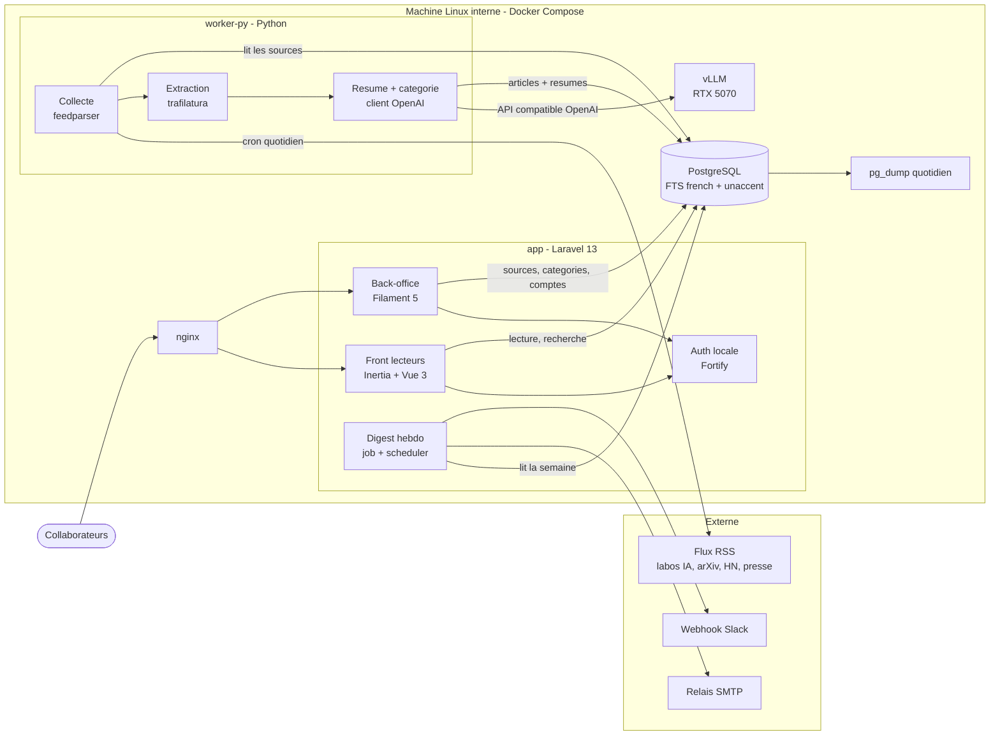

# INSTALL.md - `veille_techno`

Vision technique et guide d'installation.

## Vision

Un site interne qui collecte l'actualité IA, la résume en français et la classe par thème, pour que chaque collaborateur INNOSYS reste à jour en 5 minutes par semaine.

Environ 10 collaborateurs (développeurs, chefs de projet, commerciaux, direction) consultent une liste filtrable d'articles déjà résumés, issus de 30 à 50 sources (blogs des labos IA, arXiv, Hacker News, presse tech). Un digest hebdomadaire arrive par e-mail et sur Slack. Le différenciateur : tout tourne en interne, y compris le LLM (vLLM sur GPU local), pour 0 € de coût externe et aucune donnée envoyée à un tiers.

## Decisions

| Décision     | Choix                                                        | Pourquoi                                                                                                   |
| ------------ | ------------------------------------------------------------ | ---------------------------------------------------------------------------------------------------------- |
| Architecture | Monolithe Laravel + 1 worker Python, base PostgreSQL unique  | 10 utilisateurs, pas de temps réel, un mainteneur : le minimum de pièces. Python isole collecte et LLM.    |
| Front-end    | Vue 3 + Inertia.js (Vite) ; Filament 5 pour le back-office   | Vue sans API à maintenir ni auth SPA ; Filament fournit le CRUD admin. Pas de SEO, donc pas de SSR.        |
| Back-end     | Laravel 13 (PHP 8.4) + worker Python 3.12+                   | Compétences du mainteneur (PHP, Python) ; trafilatura/feedparser pour l'ingestion, Laravel pour le web.    |
| Database     | PostgreSQL, recherche plein texte (`french` + `unaccent`)    | Données relationnelles, ~15k articles : la FTS native suffit, pas de moteur de recherche à héberger.       |
| Auth         | Comptes locaux Laravel (Fortify) + rôle admin pour Filament  | Une seule organisation, pas de SSO requis ; l'admin crée les comptes, pas d'inscription libre.             |
| Hosting      | Docker Compose sur la machine Linux interne INNOSYS          | Budget 0 € externe ; GPU local (RTX 5070 12 Go) pour vLLM sur le même hôte.                                |

## Stack summary

- **Front-end :** Vue 3 + Inertia.js (starter kit Vue officiel Laravel), Vite, Tailwind CSS v4 ; Filament 5 (Livewire 4), repli Filament 4 si un plugin requis n'est pas compatible v5.
- **Back-end :** Laravel 13 sur PHP 8.4 (PHP-FPM) ; scheduler Laravel pour le digest ; file de jobs driver `database`. Worker Python 3.12+ : feedparser 6, trafilatura 2, psycopg 3, client `openai` pointé sur vLLM ; lancé une fois par jour par cron dans son conteneur.
- **Database :** PostgreSQL (version stable courante), configuration de recherche personnalisée `french` + `unaccent`, index GIN. Laravel possède toutes les migrations ; le worker se connecte avec un rôle sans DDL.
- **Auth :** Laravel Fortify (comptes locaux, sessions en base), rôle `admin` pour l'accès Filament.
- **Hosting :** Docker Compose sur Linux (Ryzen 7 7800X3D, 32 Go DDR5, RTX 5070 12 Go, NVMe 1 To). Services : `nginx`, `app`, `scheduler`, `worker-py`, `postgres`, `vllm`. Sauvegarde `pg_dump` quotidienne vers un autre disque ou un NAS.
- **LLM :** vLLM, image figée sur une version validée sur la RTX 5070 (sm_120, CUDA ≥ 12.8, postérieure à mai 2026). Modèle à choisir parmi ceux déjà installés ; point de départ conseillé Ministral 3 8B Instruct en FP8, `--max-model-len` 8 à 16k, `--gpu-memory-utilization` ≈ 0,85.
- **Key integrations :** flux RSS/Atom, vLLM (API compatible OpenAI), relais SMTP interne, webhook entrant Slack.

## Architecture



Laravel porte tout ce que voient les utilisateurs : pages de lecture, back-office, authentification et digest hebdomadaire. Le worker Python ne fait que collecte, extraction, résumé et catégorisation, et ne parle qu'à PostgreSQL et à vLLM. La frontière entre les deux est la base : Laravel possède le schéma, le worker écrit les articles dans une table de transit avec un statut (`pending` → `summarized`), sans aucune logique métier ni d'affichage.

## Folder structure

```
veille_techno/
├── web/                          # Laravel 13 : front lecteurs, back-office, digest
│   ├── app/
│   │   ├── Models/               # Source, Category, Article, User
│   │   ├── Http/Controllers/     # pages Inertia (liste, recherche, détail)
│   │   ├── Filament/Resources/   # CRUD des sources, catégories et comptes
│   │   ├── Jobs/                 # SendWeeklyDigest
│   │   └── Notifications/        # digest par e-mail et par Slack
│   ├── database/migrations/      # seul propriétaire du schéma
│   ├── resources/js/
│   │   ├── pages/                # pages Vue 3 (Inertia)
│   │   └── components/
│   ├── routes/                   # web.php, console.php (scheduler)
│   └── tests/
├── worker/                       # worker Python : collecte et enrichissement
│   ├── src/veille_worker/
│   │   ├── collect.py            # feedparser
│   │   ├── extract.py            # trafilatura
│   │   ├── enrich.py             # appels vLLM (résumé + catégorie)
│   │   ├── db.py                 # psycopg 3, rôle sans droits sur le schéma
│   │   └── prompts/
│   ├── tests/
│   └── pyproject.toml
├── infra/
│   ├── nginx/
│   ├── php/                      # Dockerfile PHP-FPM
│   ├── vllm/                     # image figée, paramètres du modèle
│   └── backup/                   # script pg_dump quotidien
├── docker-compose.yml
├── .env.example
└── aidd_docs/INSTALL.md
```

## Install steps

Installation manuelle : le framework ne génère pas encore ces éléments automatiquement.

1. Vérifier l'hôte : Linux à jour, pilote NVIDIA récent compatible CUDA ≥ 12.8, Docker + Docker Compose, `nvidia-container-toolkit` (test : `nvidia-smi` dans un conteneur).
2. Valider vLLM sur la RTX 5070 avant tout code : figer la version d'image qui fonctionne, choisir le modèle parmi ceux installés, faire un test de résumé en français via l'API compatible OpenAI.
3. Installer les runtimes de développement : PHP 8.4 + Composer, Node.js LTS, Python 3.12+ avec `uv` ou `pip`.
4. Créer l'application Laravel 13 dans `web/` avec le starter kit Vue, puis ajouter Filament ; créer `worker/` avec son `pyproject.toml`.
5. Préparer PostgreSQL : base, rôle applicatif Laravel (propriétaire du schéma), rôle worker sans DDL, extension `unaccent`.
6. Renseigner `.env` à partir de `.env.example` : accès base pour les deux rôles, URL et nom du modèle vLLM, relais SMTP, URL du webhook Slack.
7. Planifier la sauvegarde `pg_dump` quotidienne vers un autre disque ou un NAS, et tester une restauration.

## Audit summary

Résultats de l'audit multi-agents de l'étape 03 :

| Candidat                     | Verdict | Notes                                                                                                   |
| ---------------------------- | ------- | ------------------------------------------------------------------------------------------------------- |
| A. Laravel full-stack        | ⚠️      | Stack mature et maîtrisée ; vigilance sur vLLM et la RTX 5070 (sm_120, image figée, CUDA ≥ 12.8).        |
| **B. Laravel + worker Python** (retenu) | ⚠️ | Gain d'extraction marginal, mais acceptable : le mainteneur connaît Python. Garde-fous : Laravel seul propriétaire du schéma, rôle worker sans DDL, table de transit. |
| C. Next.js TypeScript        | ⚠️      | Auth.js figé (passer à Better Auth), back-office à construire, correctifs de sécurité Next.js à suivre de près en auto-hébergé. |
