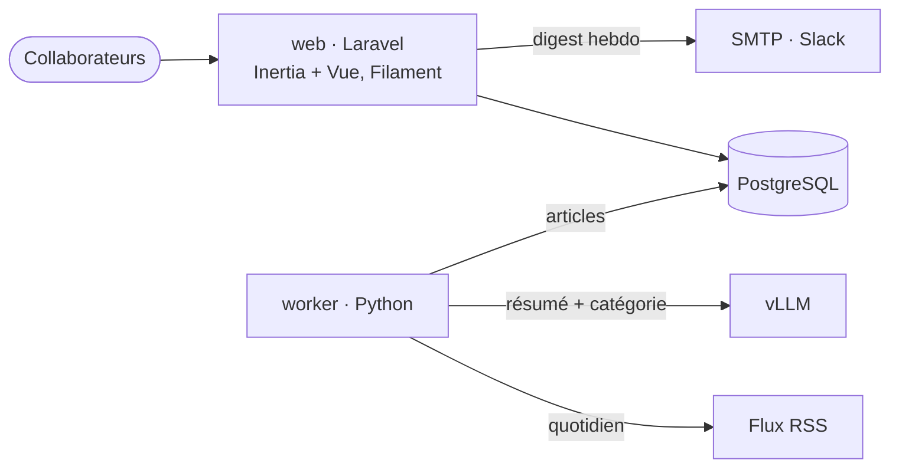

# Architecture

Cible décidée dans `aidd_docs/INSTALL.md` ; aucun code n'existe encore.

## Stack

- Laravel (PHP) : front lecteurs, back-office, auth, digest. Compétence du mainteneur, Filament fournit l'admin.
- Vue 3 + Inertia.js (Vite) pour les pages lecteurs : Vue sans API REST ni auth SPA à maintenir.
- Filament pour le back-office (sources, catégories, comptes).
- Worker Python (feedparser, trafilatura, client `openai`) : collecte, extraction, résumé, catégorisation.
- vLLM sur le GPU local (RTX 5070, 12 Go), appelé via son API compatible OpenAI.
- PostgreSQL, base unique partagée par Laravel et le worker.
- Docker Compose sur une seule machine Linux interne.

## How it fits together

## Key decisions

- Laravel est le seul propriétaire du schéma : toutes les migrations sont dans `web/`. Le worker n'a ni ORM migrant ni Alembic.
- Le worker se connecte avec un rôle Postgres sans DDL et écrit en SQL brut (psycopg 3).
- Contrat Python → Laravel par la base : un statut d'article (`pending` → `summarized`), aucune logique métier ni d'affichage dans le worker.
- Un seul appel LLM par article ; le résultat est stocké, jamais régénéré à l'affichage.
- Pas de front découplé : Inertia plutôt qu'une SPA + API, gain nul à 10 utilisateurs.
- Pas de Redis : file de jobs Laravel en driver `database`.
- Comptes locaux créés par l'admin, pas d'inscription libre, pas de SSO.

## Gotchas

- RTX 5070 (Blackwell, sm_120) : vLLM exige CUDA ≥ 12.8 ; les images officielles ont longtemps planté (« no kernel image »). Toujours figer une image déjà validée sur la carte, jamais `:latest`.
- VRAM 12 Go : Qwen3-14B-AWQ ne charge pas (OOM à la conversion AWQ). Modèle retenu Qwen3-8B-AWQ, `--gpu-memory-utilization 0.80` (0.85 tombe en OOM au warm-up). Détails : `infra/vllm/README.md`.
- Qwen3 raisonne par défaut : servir avec `--reasoning-parser qwen3` et envoyer `enable_thinking: false` à chaque requête.
- Recherche plein texte : la config `french` seule ne gère pas les accents, il faut une configuration personnalisée avec `unaccent`.
- Une seule machine, sans redondance : la sauvegarde `pg_dump` quotidienne vers un autre disque est la seule parade.
