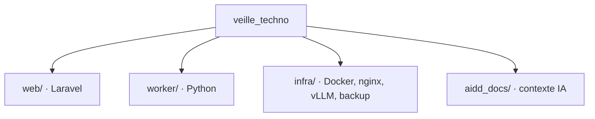

# Codebase Map

Organisation prévue ; aucun de ces dossiers n'existe encore. Arborescence détaillée : `aidd_docs/INSTALL.md`.

## Areas

- `web/` : application Laravel (pages Inertia/Vue, back-office Filament, auth, digest, migrations).
- `worker/` : worker Python de collecte et d'enrichissement LLM.
- `infra/` : Dockerfiles, configuration nginx, paramètres vLLM, script de sauvegarde.
- `aidd_docs/` : INSTALL.md et mémoire projet.

## Entry points

- `docker-compose.yml` à la racine : `docker compose up -d` démarre nginx, app, postgres et vllm ; `worker-py` (profil `tools`) se lance à la demande avec `docker compose run --rm worker-py ...`.
- `web/routes/web.php` (pages) et `web/routes/console.php` (scheduler du digest).
- Le module de collecte du worker, lancé une fois par jour par cron dans son conteneur.
