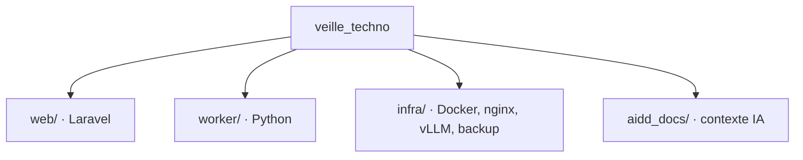

# Codebase Map

Arborescence cible détaillée : `aidd_docs/INSTALL.md`.

## Areas

- `web/` : application Laravel (pages Inertia/Vue, back-office Filament, auth, digest, migrations).
- `worker/` : worker Python de collecte et d'enrichissement LLM (`src/veille_worker/`) :
  - `collect.py` orchestration et bilan, `feeds.py` flux (feedparser), `urls.py` normalisation,
  - `extract.py` texte (trafilatura, repli flux, troncature), `llm.py` appels vLLM, `db.py` SQL brut (psycopg),
  - `crontab` planification de `worker-cron`.
- `web/app/Filament/Resources/{Users,Sources,Categories}` : back-office admin ; modèles `Source`, `Category`, `Article`.
- `infra/` : Dockerfiles, configuration nginx, paramètres vLLM, script de sauvegarde.
- `aidd_docs/` : INSTALL.md et mémoire projet.

## Entry points

- `docker-compose.yml` à la racine : `docker compose up -d` démarre nginx, app, postgres, vllm et `worker-cron` ; `worker-py` (profil `tools`, même image) se lance à la demande avec `docker compose run --rm worker-py python -m veille_worker.collect`.
- `web/routes/web.php` (pages) et `web/routes/console.php` (scheduler du digest).
- `python -m veille_worker.collect` : collecte, lancée chaque jour par `worker-cron` (supercronic, `COLLECT_SCHEDULE`).
