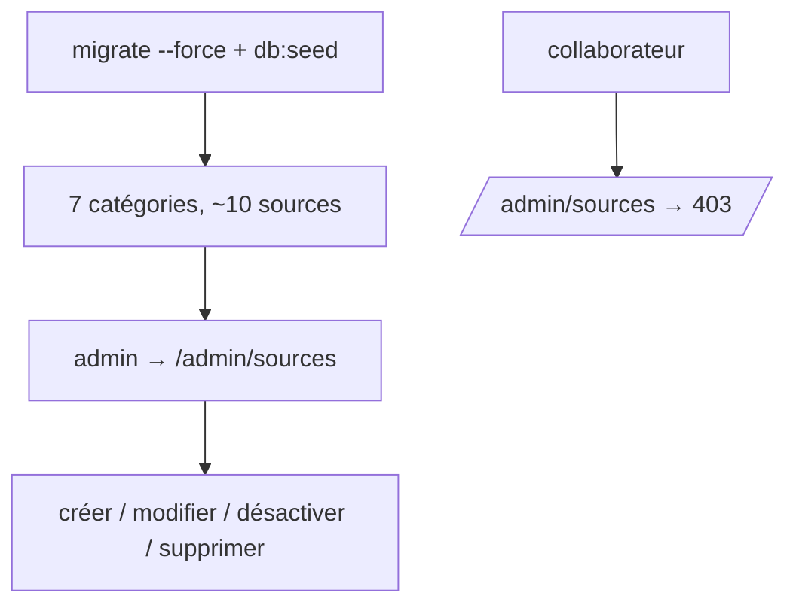
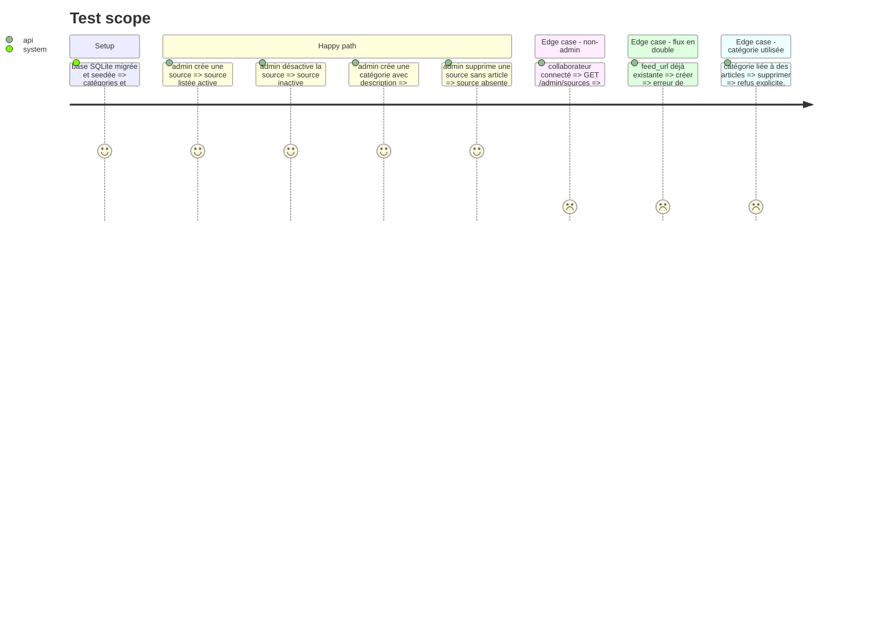

# Instruction: Schéma, seeders, ressources Filament

## Architecture projection

> Tree of the final files. ✅ create · ✏️ modify · ❌ delete

```txt
web/
├── app/
│   ├── Models/{Source,Category,Article}.php            ✅ relations, casts, statut d'article (enum)
│   ├── Enums/ArticleStatus.php                         ✅ pending / summarized / failed
│   ├── Policies/{SourcePolicy,CategoryPolicy}.php      ✅ réservées aux admins
│   └── Filament/Resources/{Sources,Categories}/        ✅ CRUD, activation d'une source
├── database/
│   ├── migrations/xxxx_create_sources_table.php        ✅ nom, feed_url unique, type rss|arxiv, active, max_items_per_run
│   ├── migrations/xxxx_create_categories_table.php     ✅ nom, slug unique, description
│   ├── migrations/xxxx_create_articles_table.php       ✅ source_id, url, normalized_url unique, titres, texte, résumé, category_id, published_at, status, attempts, last_error
│   ├── factories/{Source,Category,Article}Factory.php  ✅
│   └── seeders/{CategorySeeder,SourceSeeder}.php       ✏️ DatabaseSeeder les appelle
└── tests/Feature/Admin/{SourceResourceTest,CategoryResourceTest}.php ✅
```

## User Journey



## Test Scope



## Tasks to do

### `1)` Migrations et modèles

> Le schéma que le worker remplira.

1. Trois migrations ; clés étrangères `articles.source_id` (cascade à la suppression de la source) et `articles.category_id` (nullable, restrict).
2. Index : `normalized_url` unique, `(status, attempts)`, `published_at`.
3. Modèles, relations, enum `ArticleStatus`, factories.

### `2)` Seeders

> Démarrer avec des données utiles.

1. `CategorySeeder` : 7 catégories, slug et description orientée LLM.
2. `SourceSeeder` : ~10 flux, chacun vérifié (HTTP 200, flux valide) avant d'être ajouté ; `type=arxiv` pour arXiv ; `max_items_per_run` adapté. Idempotent (`updateOrCreate`).

### `3)` Ressources Filament

> Les admins pilotent les sources.

1. Ressources Sources et Catégories générées, libellés français, policies admin.
2. Toggle `active` dans la table des sources ; suppression d'une catégorie utilisée refusée.

### `4)` Droits du worker

> Vérifier l'étanchéité sur les nouvelles tables.

1. Sur Postgres réel après migration : `veille_worker` lit `sources`, `categories`, écrit `articles` ; `DELETE` et `CREATE` refusés.

## Test acceptance criteria

| Task | Acceptance criteria |
| ---- | ------------------- |
| 1 | les migrations passent sur Postgres et SQLite ; une URL normalisée en double est rejetée par la base |
| 2 | après seed : 7 catégories, ~10 sources actives ; relancer le seed ne crée pas de doublon |
| 3 | un admin gère sources et catégories ; un non-admin reçoit 403 ; une catégorie utilisée ne peut pas être supprimée |
| 4 | `veille_worker` lit et écrit comme prévu, `DELETE` et `CREATE` refusés |
