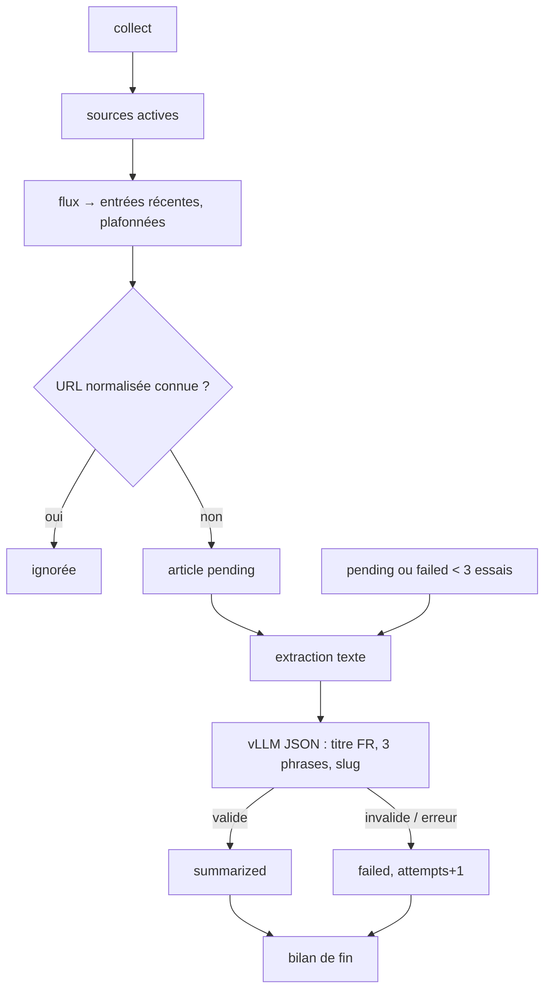
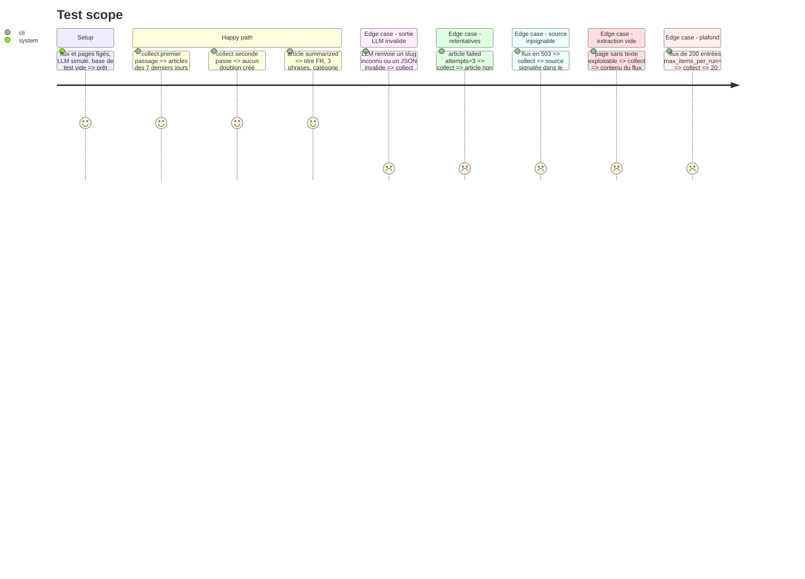

# Instruction: Pipeline worker (flux, extraction, vLLM, écriture)

## Architecture projection

> Tree of the final files. ✅ create · ✏️ modify · ❌ delete

```txt
worker/
├── pyproject.toml                         ✏️ feedparser, trafilatura, httpx (ou équivalent)
├── src/veille_worker/
│   ├── config.py                          ✏️ accès base (DB_*, WORKER_DB_PASSWORD), limites
│   ├── db.py                              ✅ psycopg : sources actives, catégories, articles connus, insert/update
│   ├── feeds.py                           ✅ lecture des flux, filtre 7 jours au premier passage, plafond par source
│   ├── urls.py                            ✅ normalisation (utm_*, fragment, casse de l'hôte)
│   ├── extract.py                         ✅ trafilatura + repli contenu du flux, arXiv = résumé, troncature
│   ├── llm.py                             ✏️ enrich_fr() : sortie JSON imposée (titre FR, 3 phrases, slug)
│   └── collect.py                         ✅ orchestration, retentatives, bilan de fin, code de sortie
└── tests/
    ├── fixtures/                          ✅ flux RSS/Atom/arXiv et pages HTML figés
    ├── test_urls.py, test_feeds.py, test_extract.py  ✅
    ├── test_llm.py                        ✏️ schéma JSON, sortie invalide
    └── test_collect.py                    ✅ base Postgres de test ou faux dépôt, doublons, échecs, source injoignable
```

## User Journey



## Test Scope



## Tasks to do

### `1)` Accès base

> Lire et écrire avec le rôle worker.

1. `config.py` : DB_HOST, DB_PORT, DB_DATABASE, DB_USERNAME, WORKER_DB_PASSWORD (déjà injectés par compose).
2. `db.py` : requêtes SQL paramétrées ; insert idempotent (`ON CONFLICT (normalized_url) DO NOTHING`).

### `2)` Flux et URLs

> Entrées récentes, uniques, plafonnées.

1. `urls.py` : supprime `utm_*` et le fragment, normalise hôte et schéma.
2. `feeds.py` : feedparser, timeout, User-Agent explicite ; premier passage d'une source (aucun article) = 7 derniers jours ; plafond `max_items_per_run`.

### `3)` Extraction

> Texte exploitable et borné.

1. trafilatura sur l'URL de l'article (timeout) ; repli contenu du flux si vide ou trop court ; `type=arxiv` = résumé du flux.
2. Troncature pour rester sous le contexte vLLM (prompt + sortie).

### `4)` Enrichissement LLM

> Sortie structurée et vérifiée.

1. `enrich_fr(text, title, categories)` : `response_format` JSON schema (vérifier la syntaxe supportée par vLLM v0.28 dans sa doc) avec `title_fr`, `summary` (tableau de 3 chaînes), `category` (`enum` des slugs) ; `max_tokens` borné ; thinking désactivé.
2. Validation côté Python (schéma) ; échec → exception dédiée.

### `5)` Orchestration

> Une source en panne n'arrête rien.

1. `collect.py` : sources → nouveaux articles → traitement des `pending` et `failed` (< 3 essais) ; bilan (sources OK/KO, nouveaux, résumés, échecs) ; code 0 si la collecte a tourné, non nul si vLLM ou la base sont indisponibles.

## Test acceptance criteria

| Task | Acceptance criteria |
| ---- | ------------------- |
| 1 | le worker n'émet aucune requête DDL ni DELETE ; un doublon d'URL ne lève pas d'erreur |
| 2 | les URLs avec `utm_*` ou fragment se dédoublonnent ; premier passage limité à 7 jours ; plafond respecté |
| 3 | une page vide bascule sur le contenu du flux ; le texte envoyé ne dépasse pas le budget |
| 4 | la requête impose le schéma ; une sortie hors schéma passe l'article en `failed` |
| 5 | une source injoignable apparaît dans le bilan sans bloquer les autres ; un article à 3 échecs n'est plus retenté |
