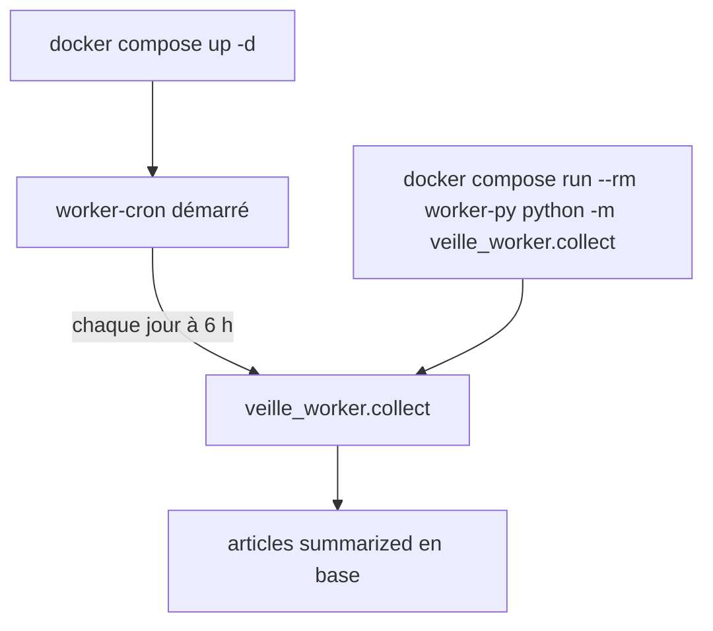
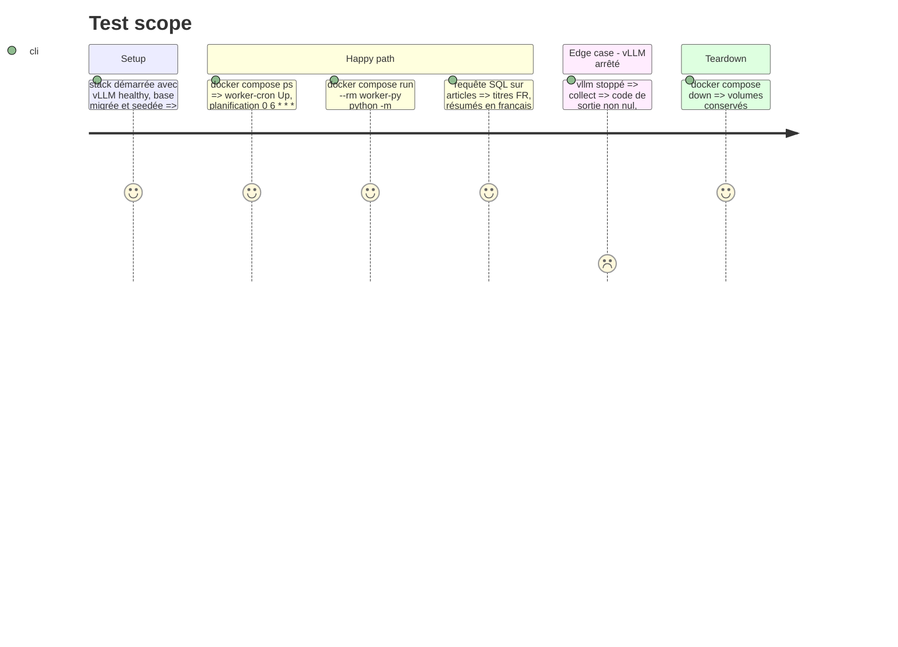

# Instruction: Planification et collecte réelle

## Architecture projection

> Tree of the final files. ✅ create · ✏️ modify · ❌ delete

```txt
.
├── docker-compose.yml               ✏️ service worker-cron (image du worker, hors profil tools)
├── .env.example                     ✏️ COLLECT_SCHEDULE (défaut « 0 6 * * * »), fuseau horaire
├── worker/
│   ├── Dockerfile                   ✏️ supercronic installé (binaire figé + somme de contrôle)
│   ├── crontab                      ✅ planification de veille_worker.collect
│   └── README.md                    ✏️ lancement manuel et planifié
└── aidd_docs/memory/
    ├── architecture.md              ✏️ pipeline de collecte, plafond, sortie structurée
    └── codebase-map.md              ✏️ worker-cron, modules du worker
```

## User Journey



## Test Scope



## Tasks to do

### `1)` Service planifié

> La collecte tourne seule chaque jour.

1. supercronic dans l'image du worker (version figée, somme de contrôle vérifiée).
2. `worker/crontab` et service `worker-cron` : mêmes variables que `worker-py`, `depends_on` postgres et vllm healthy, `restart: unless-stopped`, fuseau `Europe/Paris`.

### `2)` Collecte réelle

> Prouver le pipeline sur les vraies sources.

1. Migrer et seeder la base réelle, lancer une collecte manuelle complète.
2. Capturer : bilan de fin, `SELECT` de 5 articles (source, titre FR, résumé, catégorie), répartition par statut et par catégorie, durée totale.

### `3)` Mémoire

> Garder le contexte à jour.

1. Mettre à jour `architecture.md` et `codebase-map.md` (pipeline, plafond, sortie structurée, worker-cron).

## Test acceptance criteria

| Task | Acceptance criteria |
| ---- | ------------------- |
| 1 | `worker-cron` reste démarré et annonce la planification quotidienne ; il ne lance rien au démarrage |
| 2 | la collecte réelle laisse des articles `summarized`, en français, catégorisés ; le bilan et l'extrait SQL sont fournis |
| 3 | la mémoire décrit le pipeline et le service planifié sans contredire le code |
