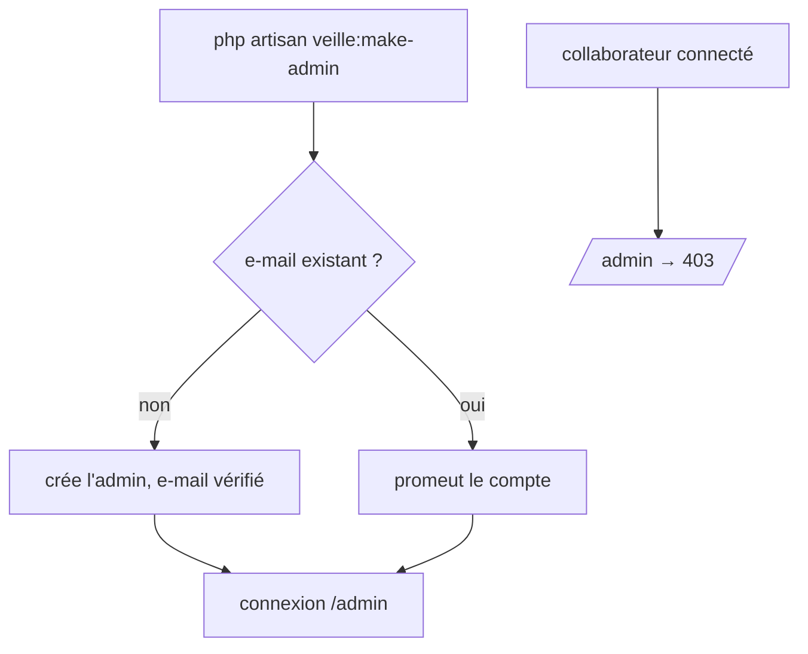
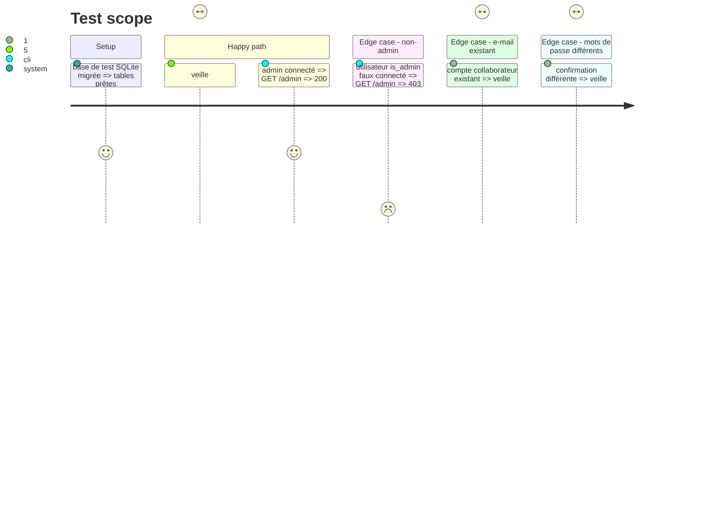

# Instruction: Rôle admin, accès au panneau, premier admin

## Architecture projection

> Tree of the final files. ✅ create · ✏️ modify · ❌ delete

```txt
web/
├── app/
│   ├── Console/Commands/
│   │   └── MakeAdmin.php                         ✅ commande veille:make-admin
│   └── Models/
│       └── User.php                              ✏️ FilamentUser, canAccessPanel, cast is_admin
├── database/
│   ├── factories/UserFactory.php                 ✏️ état admin()
│   └── migrations/
│       └── xxxx_add_is_admin_to_users_table.php  ✅ colonne is_admin (défaut false)
└── tests/Feature/
    ├── Admin/PanelAccessTest.php                 ✅ 403 non-admin, accès admin
    └── Admin/MakeAdminCommandTest.php            ✅ création et promotion
```

## User Journey



## Test Scope



## Tasks to do

### `1)` Colonne is_admin

> Distinguer les admins.

1. Migration : `is_admin` booléen, défaut `false`, non nul.
2. `User` : cast booléen ; `is_admin` hors de `#[Fillable]` (pas d'affectation de masse).
3. `UserFactory` : état `admin()`.

### `2)` Accès au panneau

> Réserver `/admin` aux admins.

1. `User implements FilamentUser`, `canAccessPanel(Panel $panel): bool` renvoie `$this->is_admin`.

### `3)` Commande premier admin

> Créer ou promouvoir un admin sans mot de passe dans un fichier.

1. `veille:make-admin` : prompts nom, e-mail (validé), mot de passe masqué + confirmation (longueur minimale des règles Fortify).
2. E-mail inconnu : crée le compte avec `email_verified_at = now()` et `is_admin = true`. E-mail connu : passe `is_admin` à vrai, ne touche pas au mot de passe, le signale.

### `4)` Tests

> Couvrir les critères 1 et 2.

1. `PanelAccessTest`, `MakeAdminCommandTest` (Pest, prompts simulés).

## Test acceptance criteria

| Task | Acceptance criteria |
| ---- | ------------------- |
| 1 | un nouveau compte n'est pas admin ; `is_admin` ne peut pas être fixé par affectation de masse |
| 2 | un non-admin connecté reçoit 403 sur `/admin`, un admin reçoit 200 |
| 3 | la commande crée un admin vérifié qui se connecte ; avec un e-mail existant elle promeut sans dupliquer ; une confirmation différente n'écrit rien |
| 4 | les tests passent dans le gate Pest |
