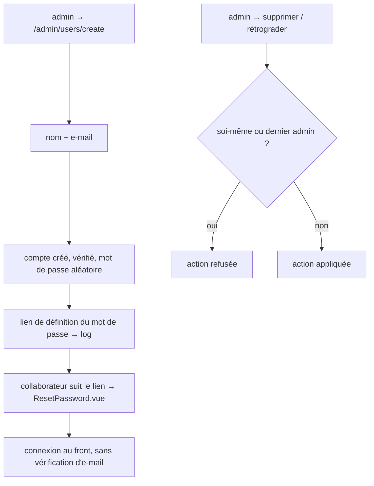
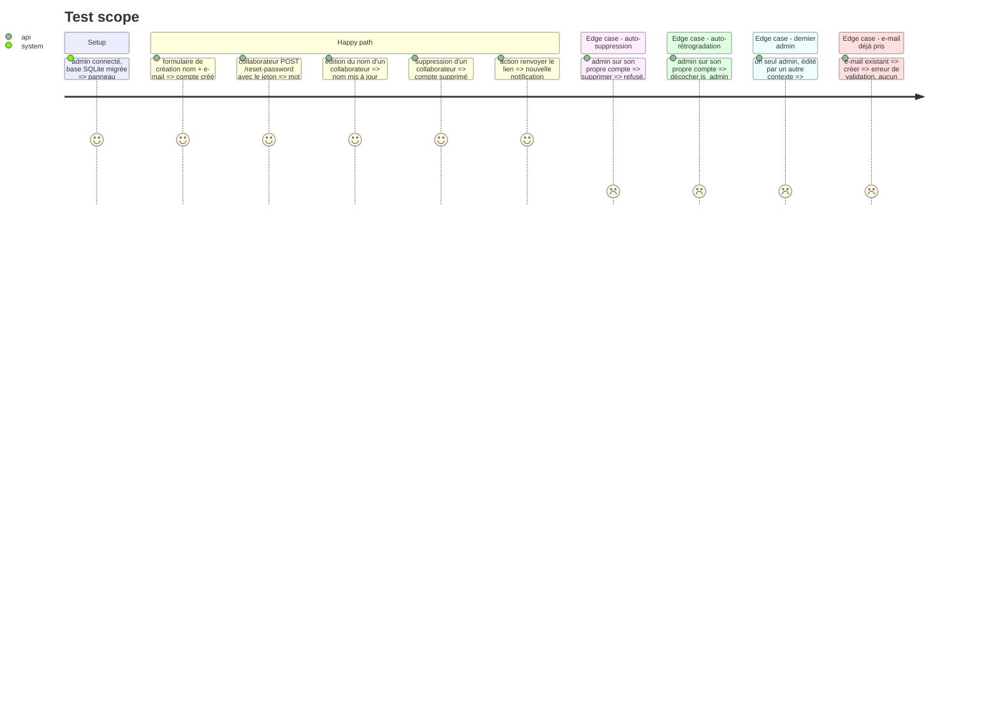

# Instruction: Ressource Filament Users et garde-fous

## Architecture projection

> Tree of the final files. ✅ create · ✏️ modify · ❌ delete

```txt
web/
├── app/
│   ├── Filament/Resources/Users/                 ✅ ressource générée (liste, création, édition)
│   │   ├── UserResource.php
│   │   ├── Pages/{ListUsers,CreateUser,EditUser}.php
│   │   ├── Schemas/UserForm.php                  ✅ nom, e-mail, is_admin ; aucun champ mot de passe
│   │   └── Tables/UsersTable.php                 ✅ colonnes, actions modifier / supprimer / renvoyer le lien
│   └── Policies/
│       └── UserPolicy.php                        ✅ garde-fous : soi-même, dernier admin
└── tests/Feature/Admin/
    ├── UserResourceTest.php                      ✅ création, invitation, édition, suppression
    └── UserGuardsTest.php                        ✅ quatre refus
```

## User Journey



## Test Scope



## Tasks to do

### `1)` Règles métier

> Une seule source de vérité pour les garde-fous.

1. `UserPolicy` : `viewAny/create/update` réservés aux admins ; `delete` refusé sur soi-même et sur le dernier admin.
2. Rétrogradation refusée sur soi-même et sur le dernier admin (règle partagée, appliquée à la sauvegarde).

### `2)` Ressource Users

> Gérer les comptes depuis Filament.

1. Générer la ressource Filament 5 pour `User`, vérifier les commandes dans la doc Filament 5.
2. Formulaire : nom, e-mail (unique), `is_admin` (désactivé sur son propre compte).
3. Table : nom, e-mail, admin, date de création ; actions modifier, supprimer (masquée si interdite), renvoyer le lien.

### `3)` Invitation

> Le collaborateur définit lui-même son mot de passe.

1. À la création : mot de passe aléatoire long, `email_verified_at = now()`, envoi du lien via le broker de réinitialisation Laravel (`Password::sendResetLink`).
2. Action « Renvoyer le lien » sur la table.

### `4)` Tests

> Couvrir les critères 3 à 5.

1. `UserResourceTest` (Livewire/Filament testing, `Notification::fake()`), `UserGuardsTest`.

## Test acceptance criteria

| Task | Acceptance criteria |
| ---- | ------------------- |
| 1 | les quatre cas interdits sont refusés, y compris hors interface |
| 2 | un admin liste, crée, édite et supprime des collaborateurs ; aucun champ mot de passe n'apparaît |
| 3 | un compte créé reçoit un lien ; avec ce lien le collaborateur définit son mot de passe et se connecte sans vérification d'e-mail ; « Renvoyer le lien » émet un nouveau lien |
| 4 | les tests passent ; pint, lint front, Pest et build verts |
