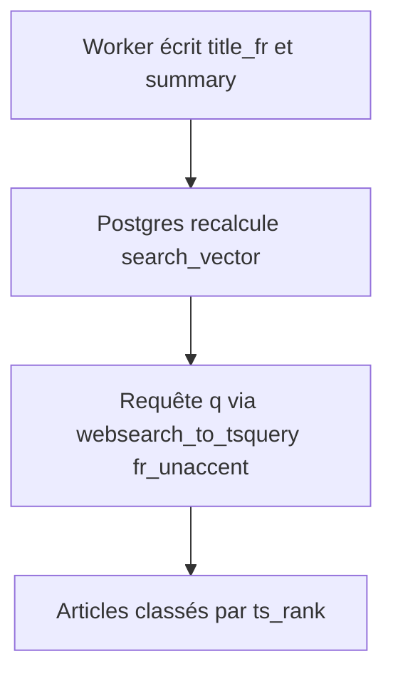
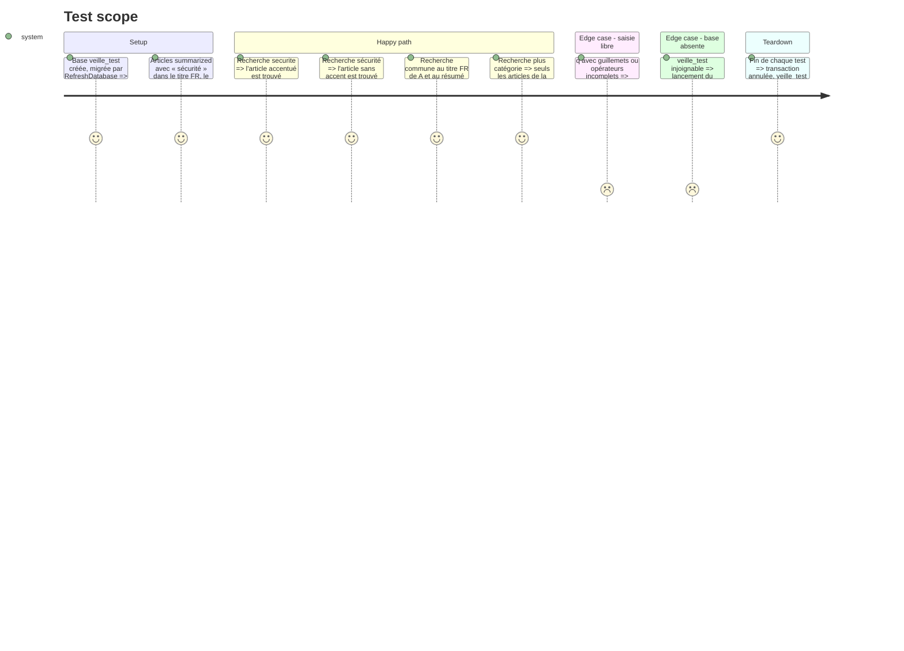

<!-- Fill or omit these sections; never add, rename, or reorder one. -->

# Instruction: recherche plein texte et base de test Postgres

## Architecture projection

> Tree of the final files. ✅ create · ✏️ modify · ❌ delete

```txt
.
├── infra/postgres/init/01-roles.sh                                   ✏️ crée aussi la base veille_test (owner veille_app)
├── web/
│   ├── database/migrations/2026_10_19_160000_add_articles_search.php ✅ unaccent, config fr_unaccent, colonne search_vector, GIN ; no-op hors pgsql
│   ├── config/database.php                                           ✏️ connexion pgsql_testing (base DB_TEST_DATABASE, défaut veille_test)
│   ├── app/Models/Article.php                                        ✏️ scopes summarized, inCategory(slug), search(q) avec classement
│   ├── tests/Pgsql/PgsqlTestCase.php                                 ✅ bascule sur pgsql_testing, ignore si base injoignable
│   ├── tests/Pgsql/ArticleSearchTest.php                             ✅ groupe pgsql : accents, poids, combinaison catégorie
│   ├── tests/Pest.php                                                ✏️ dossier Pgsql : PgsqlTestCase + RefreshDatabase + groupe pgsql
│   └── phpunit.xml                                                   ✏️ testsuite Pgsql
└── aidd_docs/memory/{coding-assertions,testing,architecture}.md      ✏️ commande du groupe pgsql, création de veille_test, colonne search_vector
```

## User Journey



## Test Scope



## Tasks to do

### `1)` Base de test

> Une base `veille_test` existe, possédée par `veille_app`, sans toucher `veille`.

1. Ajouter `CREATE DATABASE veille_test OWNER veille_app` à `01-roles.sh` (volumes neufs).
2. Sur le volume existant, la créer une fois en superutilisateur : `docker compose exec postgres psql -U postgres -c "CREATE DATABASE veille_test OWNER veille_app"`.
3. Ajouter la connexion `pgsql_testing` dans `config/database.php` (copie de `pgsql`, base `env('DB_TEST_DATABASE', 'veille_test')`).

### `2)` Migration de recherche

> `articles.search_vector` se calcule seul et s'interroge sans accents.

1. Sortir tôt si le driver n'est pas `pgsql` (SQLite des tests).
2. `CREATE EXTENSION IF NOT EXISTS unaccent`.
3. `CREATE TEXT SEARCH CONFIGURATION fr_unaccent (COPY = french)` puis `ALTER MAPPING FOR hword, hword_part, word WITH unaccent, french_stem`.
4. Colonne `search_vector tsvector GENERATED ALWAYS AS (setweight(to_tsvector('fr_unaccent', coalesce(title_fr,'')),'A') || setweight(…summary…,'B') || setweight(…title…,'C')) STORED`.
5. Index GIN sur `search_vector`.
6. `down()` : index, colonne, configuration (l'extension reste, créée aussi par l'init).

### `3)` Scopes du modèle

> Le contrôleur compose filtre, recherche et tri sans SQL brut.

1. `scopeSummarized` : statut `summarized`.
2. `scopeInCategory(?string $slug)` : `whereHas('category', slug)` si renseigné.
3. `scopeSearch(?string $q)` : si `q` non vide, `whereRaw("search_vector @@ websearch_to_tsquery('fr_unaccent', ?)")` et tri `ts_rank` décroissant ; sinon tri `published_at desc nulls last`, puis `created_at desc`, puis `id desc`.

### `4)` Groupe de tests pgsql

> Le SQL de recherche est testé sur Postgres, sans risque pour la base `veille`.

1. `PgsqlTestCase` : après création de l'application, `database.default = pgsql_testing` ; si la connexion échoue, `markTestSkipped`.
2. `Pest.php` : `pest()->extend(PgsqlTestCase::class)->use(RefreshDatabase::class)->group('pgsql')->in('Pgsql')`.
3. `phpunit.xml` : ajouter la testsuite `Pgsql`.
4. Écrire `ArticleSearchTest.php` selon le Test Scope.

### `5)` Mémoire projet

> Les gates et pièges sont documentés.

1. `coding-assertions.md` : commande du groupe `pgsql` (before push) et création de `veille_test`.
2. `testing.md` : convention du groupe `pgsql`.
3. `architecture.md` : colonne générée `search_vector`, config `fr_unaccent` (remplace le piège « config french seule »).

## Test acceptance criteria

| Task | Acceptance criteria                                                                                 |
| ---- | --------------------------------------------------------------------------------------------------- |
| 1    | `veille_test` existe et appartient à `veille_app` ; la base `veille` n'est pas modifiée par les tests |
| 2    | `migrate --force` passe sur `veille` (171 articles) ; `search_vector` est rempli pour les articles résumés ; `migrate` passe aussi en SQLite |
| 2    | Le worker écrit toujours : `uv run pytest -m db` vert après la migration                             |
| 3    | Sans `q`, ordre du plus récent au plus ancien ; avec `q`, ordre par pertinence                       |
| 4    | `pest --group=pgsql` vert avec la base ; ignoré sans échec quand la base est absente                 |
| 4    | `pest --exclude-group=slow` passe toujours en SQLite                                                 |
| 5    | Les trois fichiers de mémoire décrivent la commande et la convention                                 |
