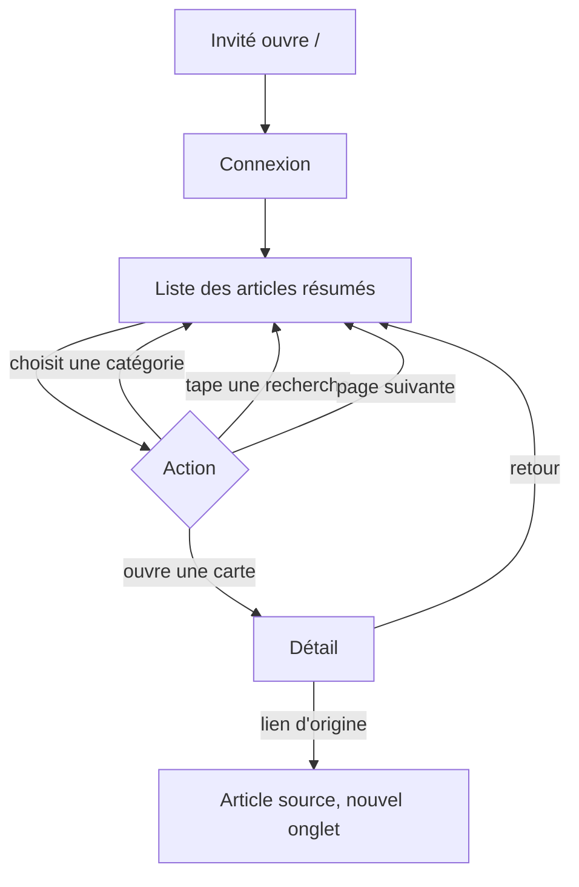
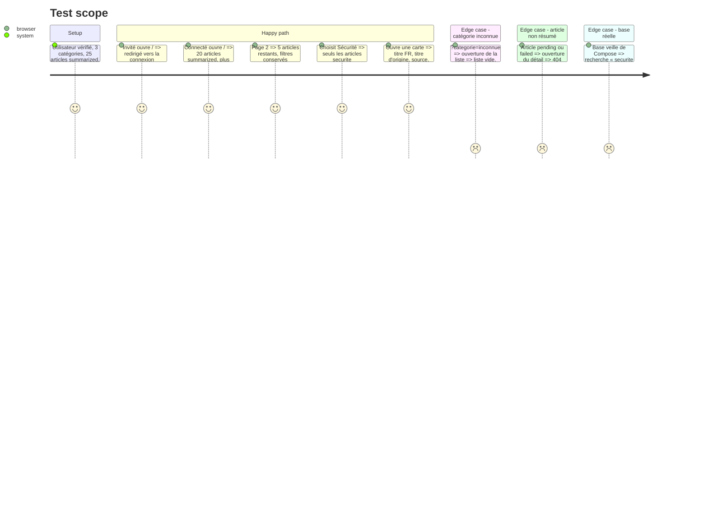

<!-- Fill or omit these sections; never add, rename, or reorder one. -->

# Instruction: pages de lecture et navigation

## Architecture projection

> Tree of the final files. ✅ create · ✏️ modify · ❌ delete

```txt
web/
├── app/Http/Controllers/ArticleController.php       ✅ index (filtre, recherche, pagination) et show (404 hors summarized)
├── routes/web.php                                   ✏️ / → articles.index, /articles/{article} → articles.show, sous auth+verified ; dashboard et Welcome retirés
├── config/fortify.php                               ✏️ home = '/'
├── resources/js/pages/articles/Index.vue            ✅ liste, filtre, recherche, pagination
├── resources/js/pages/articles/Show.vue             ✅ détail
├── resources/js/components/ArticleCard.vue          ✅ carte d'un article
├── resources/js/components/AppSidebar.vue           ✏️ entrée « Articles », liens du kit retirés
├── resources/js/components/AppHeader.vue            ✏️ idem
├── resources/js/pages/Dashboard.vue                 ❌ remplacé par la liste
├── resources/js/pages/Welcome.vue                   ❌ / réservé aux connectés
├── tests/Feature/ArticlePagesTest.php               ✅ accès, liste, tri, filtre, pagination, détail, 404
├── tests/Feature/DashboardTest.php                  ❌ route supprimée
├── tests/Feature/PublicPagesTest.php                ✏️ / redirige un invité vers la connexion
└── tests/Feature/{Auth,Admin}/*.php                 ✏️ route('dashboard') → route('articles.index')
```

## User Journey



## Test Scope



## Wireframe

```txt
Liste (/)
┌──────────────┬────────────────────────────────────────────────┐
│ (1) Sidebar  │ (2) [ Rechercher…          ] [Catégorie ▾]      │
│  Articles    ├────────────────────────────────────────────────┤
│  Admin*      │ (3) ┌────────────────────────────────────────┐ │
│              │     │ (4) [Catégorie] Source · date           │ │
│              │     │     Titre FR                            │ │
│              │     │     Phrase 1 / Phrase 2 / Phrase 3      │ │
│              │     └────────────────────────────────────────┘ │
│              │     ┌────────────────────────────────────────┐ │
│              │     │ …                                       │ │
│              │     └────────────────────────────────────────┘ │
│              ├────────────────────────────────────────────────┤
│              │ (5) ‹ Précédent   page 1 / 8   Suivant ›        │
└──────────────┴────────────────────────────────────────────────┘

Détail (/articles/{id})
┌──────────────┬────────────────────────────────────────────────┐
│ (1) Sidebar  │ (6) ‹ Retour à la liste                          │
│              │ (7) [Catégorie] Source · date                   │
│              │     Titre FR                                    │
│              │     Titre d'origine                             │
│              │ (8) Phrase 1                                    │
│              │     Phrase 2                                    │
│              │     Phrase 3                                    │
│              │ (9) [ Lire l'article d'origine ↗ ]              │
└──────────────┴────────────────────────────────────────────────┘
```

1. Sidebar : navigation de l'app ; lien admin seulement pour un admin s'il existe déjà.
2. Barre de filtres : recherche et catégorie, appliquées via l'URL.
3. Liste paginée des articles résumés, ou message si vide.
4. Carte : catégorie, source, date, titre FR, résumé ; cliquable vers le détail.
5. Pagination, filtres conservés.
6. Retour à la liste avec les filtres d'origine.
7. En-tête du détail : méta, titres FR et d'origine.
8. Résumé, une phrase par ligne.
9. Lien vers l'article source, nouvel onglet.

## Tasks to do

### `1)` Routes et contrôleur

> `/` et `/articles/{article}` servent les pages Inertia aux connectés vérifiés.

1. `ArticleController@index` : valider `q` (chaîne, 200 max) et `categorie` (chaîne) ; `Article::summarized()->inCategory()->search()->with(['source:id,name','category:id,name,slug'])->paginate(20)->withQueryString()` ; props `articles`, `categories` (nom, slug), `filters`.
2. N'exposer que les champs affichés (pas `content`, `last_error`, `search_vector`).
3. En SQLite (tests), `search()` ne doit pas être appelé avec un `q` : les tests SQLite n'envoient pas de recherche.
4. `ArticleController@show` : 404 si l'article n'est pas `summarized` ; props du détail.
5. `routes/web.php` : groupe `auth`, `verified` ; `/` nommée `articles.index`, `/articles/{article}` nommée `articles.show` ; retirer `home`/Welcome et `dashboard`.
6. `config/fortify.php` : `home` = `/`.

### `2)` Pages Vue

> L'écran correspond au wireframe, en français.

1. `ArticleCard.vue` : composants `card` et `badge` existants ; résumé découpé par ligne.
2. `articles/Index.vue` : `input` de recherche (soumission à Entrée, `router.get` avec `preserveState`), `select` de catégorie (« Toutes »), liste, message vide, pagination à partir des liens du paginateur.
3. `articles/Show.vue` : wireframe détail ; lien `target="_blank" rel="noopener noreferrer"` ; retour vers la liste.
4. Routes Wayfinder générées (`@/routes/articles`), jamais d'URL en dur.

### `3)` Navigation

> L'app n'a plus de traces du kit de démarrage dans la navigation.

1. `AppSidebar.vue` et `AppHeader.vue` : entrée « Articles » vers `articles.index`, logo vers la liste ; retirer les liens Repository et Documentation du kit.
2. Supprimer `Dashboard.vue` et `Welcome.vue`.

### `4)` Tests

> Les comportements du contrat sont couverts en SQLite.

1. `ArticlePagesTest.php` selon le Test Scope (assertions Inertia sur composant et props).
2. Supprimer `DashboardTest.php` ; adapter `PublicPagesTest.php` et les tests Auth/Admin qui visent `dashboard`.

### `5)` Contrôle sur la base réelle

> Preuve visuelle sur les 160 articles.

1. `W npm run build`, puis connexion avec un compte de test temporaire (créé puis supprimé, ou l'admin si l'utilisateur l'a créé).
2. Captures : liste, filtre Sécurité, recherche « securite » et « sécurité », détail ; enregistrées dans le dossier de la tâche.

## Test acceptance criteria

| Task | Acceptance criteria                                                                       |
| ---- | ----------------------------------------------------------------------------------------- |
| 1    | Invité redirigé vers la connexion sur `/` et `/articles/{id}` ; après connexion, arrivée sur `/` |
| 1    | 20 articles par page, summarized seulement, plus récents d'abord ; filtres conservés en page 2 |
| 1    | Catégorie inconnue : liste vide sans erreur ; article pending/failed : 404                |
| 1    | Les props n'exposent ni `content` ni `last_error`                                          |
| 2    | La liste et le détail suivent le wireframe ; le lien d'origine s'ouvre dans un nouvel onglet |
| 3    | Aucun lien vers Dashboard, Repository ou Documentation ; aucune erreur de build           |
| 4    | `pest --exclude-group=slow`, `npm run lint`, `pint --test` verts                           |
| 5    | Captures : recherche avec et sans accent donnent les mêmes articles sur la base réelle      |
