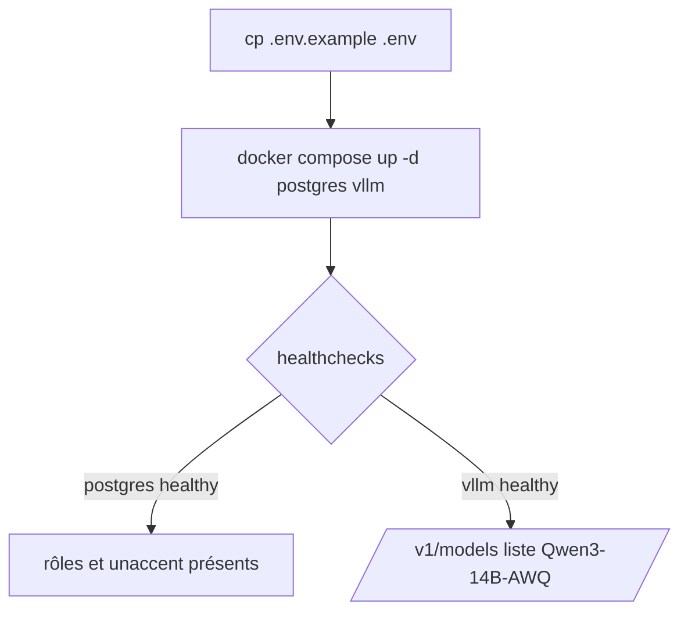
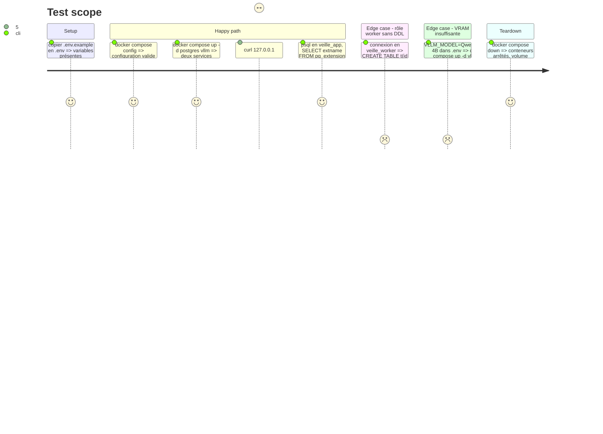

# Instruction: Infrastructure Compose, Postgres, vLLM

## Architecture projection

> Tree of the final files. ✅ create · ✏️ modify · ❌ delete

```txt
.
├── docker-compose.yml            ✅ services postgres, vllm (app, nginx, worker-py ajoutés en phases 2-3)
├── .env.example                  ✅ variables documentées, aucun secret
├── .gitignore                    ✅ .env, vendor, node_modules, .venv, caches
└── infra/
    ├── postgres/
    │   └── init/
    │       └── 01-roles.sh       ✅ rôles veille_app (propriétaire) et veille_worker (sans DDL), extension unaccent
    └── vllm/
        └── README.md             ✅ image figée, modèle, paramètres, procédure de repli Qwen3-4B
```

## User Journey



## Test Scope



## Tasks to do

### `1)` Fichiers de base

> Ignorer les secrets et documenter la configuration.

1. `.gitignore` racine : `.env`, `vendor/`, `node_modules/`, `.venv/`, `__pycache__/`, `.pytest_cache/`, `.ruff_cache/`.
2. `.env.example` : `POSTGRES_*` (superuser), `APP_DB_PASSWORD`, `WORKER_DB_PASSWORD`, `VLLM_MODEL=Qwen/Qwen3-8B-AWQ`, `VLLM_MAX_MODEL_LEN=8192`, `VLLM_GPU_MEMORY_UTILIZATION=0.80` (amendé, voir plus bas), `VLLM_BASE_URL=http://vllm:8000/v1`, chacune commentée.

### `2)` Service postgres

> Base unique, deux rôles, recherche sans accent.

1. Image `postgres:16` (déjà présente localement), volume nommé `postgres_data`, healthcheck `pg_isready`.
2. `infra/postgres/init/01-roles.sh` monté dans `/docker-entrypoint-initdb.d` : base `veille`, rôle `veille_app` propriétaire de la base et du schéma `public`, rôle `veille_worker` avec `CONNECT`, `USAGE` sur `public`, `SELECT/INSERT/UPDATE` par défaut sur les tables futures de `veille_app` (`ALTER DEFAULT PRIVILEGES`), sans `CREATE`.
3. `CREATE EXTENSION unaccent` dans la base `veille`.
4. Port non publié sur l'hôte.

### `3)` Service vllm

> LLM local figé, joignable seulement de la machine.

1. Image `vllm/vllm-openai@sha256:61fc8a896b0a4fbbbdc063bc4b0dbc25ce98e02b5050c24aeb7830ac02039b14`.
2. GPU via `deploy.resources.reservations.devices` (driver nvidia, count 1).
3. Commande : `--model ${VLLM_MODEL} --max-model-len ${VLLM_MAX_MODEL_LEN} --gpu-memory-utilization ${VLLM_GPU_MEMORY_UTILIZATION} --reasoning-parser qwen3`.
4. Volume externe `agent-editorial_vllm_hf_cache` monté en lecture seule sur `/root/.cache/huggingface`, `HF_HUB_OFFLINE=1`.
5. Ports `127.0.0.1:8000:8000`, `ipc: host` (ou `shm_size`), healthcheck sur `/health` avec `start_period` long (chargement du modèle).
6. `infra/vllm/README.md` : image et digest, modèle, paramètres, repli Qwen3-4B, désactivation du thinking par requête.

## Amendement 2026-10-19

Suit le contrat amendé ; les tâches ci-dessus gardent la rédaction d'origine.

- Tâche 1.2 et parcours de test : `VLLM_MODEL=Qwen/Qwen3-8B-AWQ` ; `/v1/models` liste `Qwen/Qwen3-8B-AWQ` (et non `Qwen3-14B-AWQ`, OOM sur la RTX 5070).
- Tâche 3.4 : volume nommé `hf_cache` propre au projet, en lecture-écriture sur `/root/.cache/huggingface`, au lieu du volume externe `agent-editorial_vllm_hf_cache` en lecture seule. `HF_HUB_OFFLINE` vient de `VLLM_HF_HUB_OFFLINE` (`0` par défaut : le premier démarrage télécharge le modèle ; `1` une fois en cache).
- Critère 3 : « sans téléchargement » ne vaut qu'une fois le modèle en cache ; le premier démarrage télécharge.
- Tâche 2.1 : healthcheck `pg_isready -h 127.0.0.1` (TCP), qui ne passe qu'après les scripts d'init ; `TEMPORARY` retiré à `PUBLIC` dans `01-roles.sh`.

## Test acceptance criteria

| Task | Acceptance criteria |
| ---- | ------------------- |
| 1 | `.env` n'est pas suivi par git ; chaque variable de `.env.example` porte un commentaire |
| 2 | postgres devient healthy ; `unaccent` est installée ; `veille_worker` reçoit une erreur de permission sur `CREATE TABLE` |
| 3 | vllm devient healthy sans téléchargement ; `/v1/models` liste le modèle de `.env` ; le port 8000 n'écoute que sur 127.0.0.1 |
