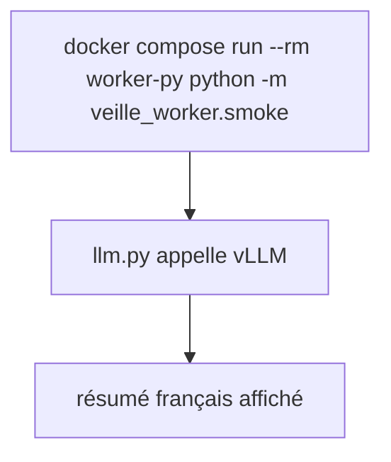
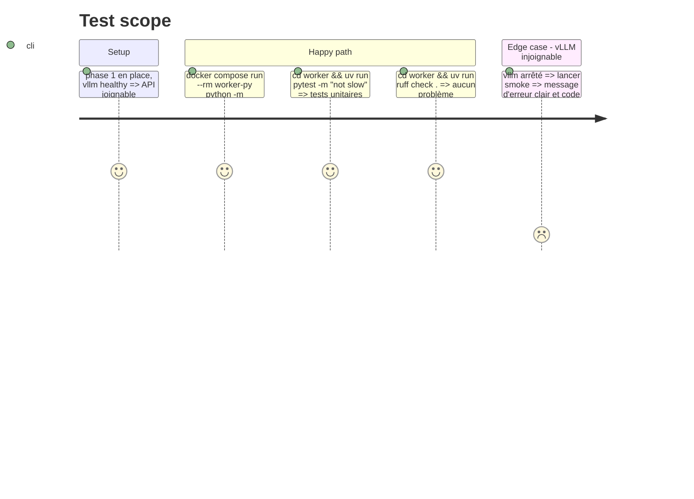

# Instruction: Worker Python et test vLLM

## Architecture projection

> Tree of the final files. ✅ create · ✏️ modify · ❌ delete

```txt
.
├── docker-compose.yml            ✏️ service worker-py
└── worker/
    ├── pyproject.toml            ✅ projet uv, dépendances openai, psycopg[binary]; dev ruff, pytest; marqueur slow
    ├── uv.lock                   ✅ verrou des dépendances
    ├── Dockerfile                ✅ image python 3.12 slim + uv
    ├── src/veille_worker/
    │   ├── __init__.py           ✅
    │   ├── config.py             ✅ lecture des variables d'environnement
    │   ├── llm.py                ✅ client OpenAI vers vLLM, thinking désactivé
    │   └── smoke.py              ✅ commande de test : résume un texte figé en français
    └── tests/
        ├── test_llm.py           ✅ unitaire, client simulé
        └── test_smoke_vllm.py    ✅ marqué slow, appelle le vLLM réel
```

## User Journey



## Test Scope



## Tasks to do

### `1)` Projet uv

> Squelette Python installable et testable.

1. `uv init --package` dans `worker/`, nom `veille_worker`, Python ≥ 3.12.
2. Dépendances `openai`, `psycopg[binary]` ; dev `ruff`, `pytest` ; marqueur pytest `slow` déclaré.

### `2)` Client LLM

> Un seul point d'appel à vLLM.

1. `config.py` : `VLLM_BASE_URL`, `VLLM_MODEL`, timeout.
2. `llm.py` : `summarize_fr(text) -> str` via `chat.completions.create`, `extra_body={"chat_template_kwargs": {"enable_thinking": False}}`, prompt système « résume en français en 3 phrases ».
3. Erreur de connexion transformée en exception explicite.

### `3)` Commande de test et tests

> Prouver la chaîne worker → vLLM.

1. `smoke.py` (`python -m veille_worker.smoke`) : texte anglais figé, affiche le résumé, code 1 si vide ou erreur.
2. `test_llm.py` : client simulé, vérifie le modèle, le flag thinking et le retour.
3. `test_smoke_vllm.py` (`slow`) : appel réel, résumé non vide.

### `4)` Conteneur

> Le worker tourne dans Compose.

1. `Dockerfile` : python 3.12 slim, uv, `uv sync --frozen --no-dev`.
2. Service `worker-py` : `env_file`, `VLLM_BASE_URL=http://vllm:8000/v1`, `depends_on` vllm healthy et postgres healthy, sans commande longue (lancé à la demande).

## Test acceptance criteria

| Task | Acceptance criteria |
| ---- | ------------------- |
| 1 | `uv sync` installe le projet ; `uv run pytest` découvre les tests |
| 2 | chaque requête envoie le modèle configuré avec le thinking désactivé ; la réponse ne contient pas de bloc de raisonnement |
| 3 | la commande de test affiche un résumé en français ; elle sort en erreur explicite quand vLLM est arrêté |
| 4 | `docker compose run --rm worker-py python -m veille_worker.smoke` réussit depuis le réseau Compose |
