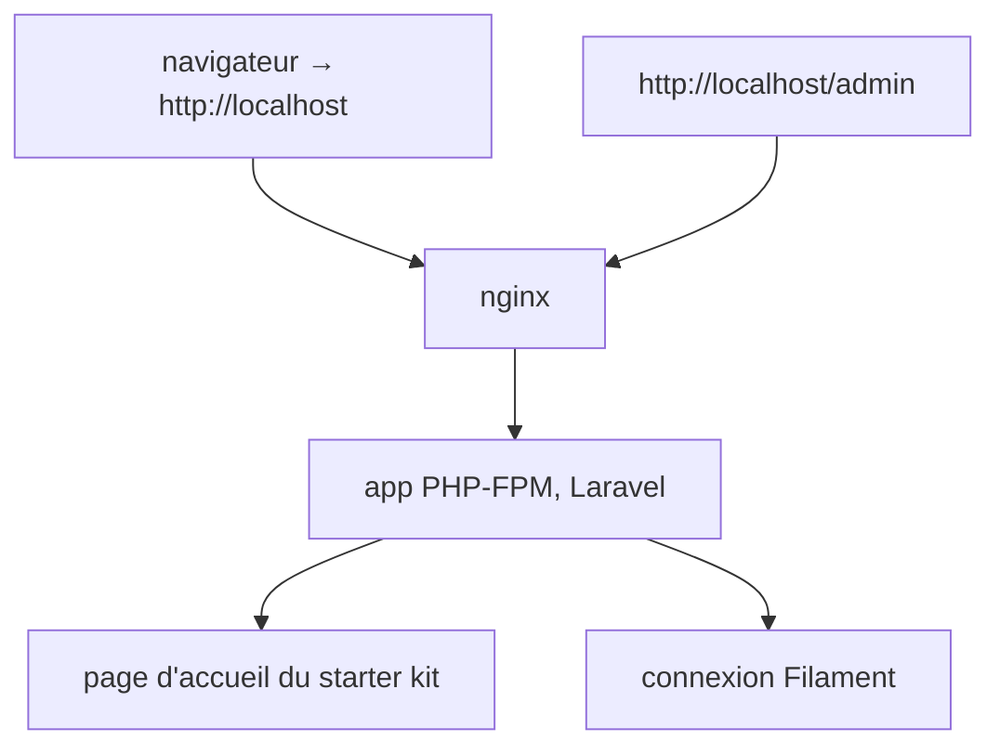
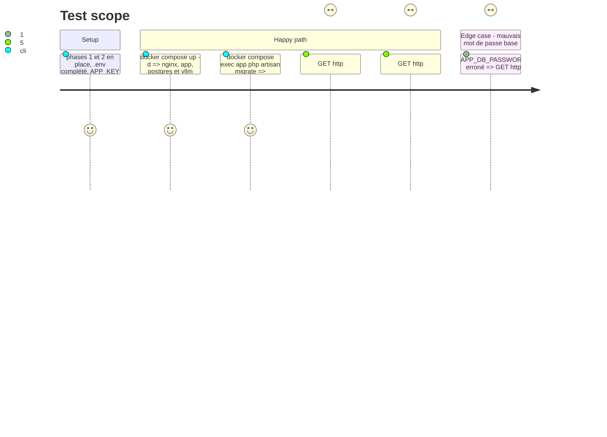

# Instruction: Application Laravel, Filament, nginx

## Architecture projection

> Tree of the final files. ✅ create · ✏️ modify · ❌ delete

```txt
.
├── docker-compose.yml            ✏️ services app et nginx
├── .env.example                  ✏️ variables Laravel (APP_KEY vide, DB_* vers veille_app)
├── infra/
│   ├── php/
│   │   └── Dockerfile            ✅ php 8.4-fpm, extensions pdo_pgsql, intl, zip; composer
│   └── nginx/
│       └── default.conf          ✅ proxy FastCGI vers app:9000, racine web/public
└── web/                          ✅ Laravel 13, starter kit Vue (Inertia), Pest
    ├── app/Providers/Filament/
    │   └── AdminPanelProvider.php ✅ panneau /admin, aucune ressource
    ├── config/database.php       ✏️ connexion pgsql par défaut
    └── tests/                    ✅ tests du starter kit, passants sur PostgreSQL ou SQLite
```

## User Journey



## Test Scope



## Tasks to do

### `1)` Squelette Laravel

> Application Vue officielle dans `web/`.

1. Créer `web/` à partir du starter kit Vue officiel de Laravel 13 (Inertia, Pest), en vérifiant la commande exacte dans la doc Laravel.
2. Configurer `pgsql` par défaut, base `veille`, utilisateur `veille_app`.

### `2)` Filament

> Panneau d'administration vide.

1. `composer require filament/filament` (v5, compatibilité Laravel 13 vérifiée dans la doc Filament, repli v4 sinon).
2. Installer le panneau `admin` sur `/admin`, sans ressource.

### `3)` Conteneurs PHP et nginx

> Servir Laravel derrière nginx.

1. `infra/php/Dockerfile` : `php:8.4-fpm`, extensions `pdo_pgsql`, `intl`, `zip`, Composer.
2. `infra/nginx/default.conf` : racine `web/public`, FastCGI vers `app:9000`.
3. Services `app` (monte `web/`, `depends_on` postgres healthy) et `nginx` (port `80`).
4. Assets front construits par `npm run build` dans `web/`.

### `4)` Gates

> Les contrôles de `coding-assertions.md` passent.

1. `pint --test`, `npm run lint`, `pest`, `npm run build` verts sur le squelette.

## Test acceptance criteria

| Task | Acceptance criteria |
| ---- | ------------------- |
| 1 | `php artisan migrate --force` (APP_ENV=production) crée les tables avec le rôle `veille_app` |
| 2 | `/admin` affiche la connexion Filament, aucune ressource n'est déclarée |
| 3 | `http://localhost` affiche la page d'accueil via nginx ; le port PHP-FPM n'est pas publié sur l'hôte |
| 4 | pint, lint front, Pest et build front passent |
